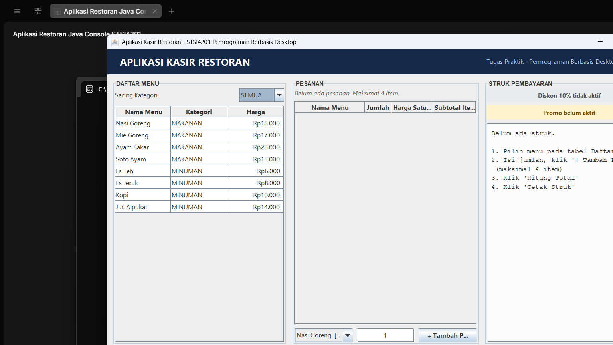

# Aplikasi Kasir Restoran — Pemrograman Berbasis Desktop (STSI4201)

Tugas Praktik Universitas Terbuka, mata kuliah **STSI4201 Pemrograman Berbasis Desktop**.
Aplikasi kasir restoran sederhana yang tersedia dalam **dua versi** dari aturan bisnis yang sama:

| Versi | File utama | Keterangan |
|---|---|---|
| **Console (Terminal)** | `Main.java` | interaksi memakai `Scanner` + `System.out.println` |
| **GUI (Desktop)** | `RestoranApp.java` | interaksi memakai **Java Swing** (JFrame, JTable, JButton, dll.) |

Seluruh aturan bisnis (perhitungan, diskon, pajak, biaya pelayanan, promo, struk) berada di
satu class yaitu `LogikaRestoran.java`, sehingga **tidak ada logika yang ditulis dua kali**.

---

## Screenshot



---

## Fitur

- Menampilkan daftar menu **dikelompokkan** berdasarkan kategori (MAKANAN / MINUMAN).
- Memesan menu melalui **JComboBox** + **JTextField** jumlah + tombol **Tambah Pesanan**.
- Maksimal **4 item** pesanan; jika ditambah ke-5 muncul `JOptionPane` peringatan.
- Menghitung **subtotal**, **diskon 10%**, **promo beli 1 gratis 1**, **pajak 10%**,
  dan **biaya pelayanan Rp20.000**.
- Tombol **Hitung Total**, **Cetak Struk**, dan **Reset** (dengan konfirmasi).
- Panel status promo: *"Diskon 10% Aktif"* dan *"Promo Beli 1 Gratis 1 Es Teh Aktif"*.
- Klik baris pada tabel menu → otomatis terisi di ComboBox pesanan.
- Penyaring tampilan menu: SEMUA / MAKANAN / MINUMAN.

---

## Aturan Bisnis

| Aturan | Nilai |
|---|---|
| Maksimal item pesanan | 4 |
| Maksimal porsi per menu | 10 |
| Diskon | 10% jika subtotal > Rp100.000 |
| Promo | subtotal > Rp50.000 **DAN** Es Teh dibeli minimal 2 → 1 gelas gratis (Rp6.000) |
| Pajak | 10% dari subtotal |
| Biaya pelayanan | Rp20.000 |
| Rumus total | `subtotal − diskon − bonusPromo + pajak + biayaPelayanan` |

### Daftar menu

| No | Nama Menu | Kategori | Harga |
|---:|---|---|---:|
| 1 | Nasi Goreng | MAKANAN | Rp18.000 |
| 2 | Mie Goreng | MAKANAN | Rp17.000 |
| 3 | Ayam Bakar | MAKANAN | Rp28.000 |
| 4 | Soto Ayam | MAKANAN | Rp15.000 |
| 5 | Es Teh | MINUMAN | Rp6.000 |
| 6 | Es Jeruk | MINUMAN | Rp8.000 |
| 7 | Kopi | MINUMAN | Rp10.000 |
| 8 | Jus Alpukat | MINUMAN | Rp14.000 |

### Contoh perhitungan

| Skenario | Pesanan | Subtotal | Diskon | Promo | Pajak | Biaya | **Total** |
|---|---|---:|---:|---:|---:|---:|---:|
| 1 — total < 50.000 | Nasi Goreng 1, Soto Ayam 1, Es Teh 1 | 39.000 | 0 | 0 | 3.900 | 20.000 | **62.900** |
| 2 — dapat promo | Ayam Bakar 2, Es Teh 2 | 68.000 | 0 | 6.000 | 6.800 | 20.000 | **88.800** |
| 3 — promo + diskon | Ayam Bakar 3, Jus Alpukat 1, Es Teh 2 | 110.000 | 11.000 | 6.000 | 11.000 | 20.000 | **124.000** |

---

## Struktur Project

```
AppRestoran/
├── Menu.java            class menu: atribut, constructor, getter, formatRupiah
├── LogikaRestoran.java  seluruh aturan bisnis (dipakai console & GUI)
├── RendererRupiah.java  merapikan kolom angka pada JTable
├── PanelMenu.java       PANEL A : JTable daftar menu + filter kategori
├── PanelPesanan.java    PANEL B : input pesanan + PANEL C : JTable pesanan
├── PanelStruk.java      PANEL E : JTextArea struk + PANEL F : status promo
├── RestoranFrame.java   PANEL D : JFrame utama + tombol aksi
├── RestoranApp.java     main() versi GUI
├── Main.java            versi console
├── docs/
│   └── screenshot-gui.png
├── .gitignore
└── README.md
```

---

## Cara Menjalankan

### 1. Tanpa NetBeans (CMD / PowerShell)

```bash
cd "C:\path\ke\AppRestoran"         # ganti dengan folder Anda
javac *.java
java RestoranApp                  # versi GUI (Swing)
java Main                         # versi console (terminal)
```

### 2. NetBeans IDE

1. **File → New Project → Java with Ant → Java Application**.
2. Nama proyek `AppRestoran`, **pilih folder** proyek ini, **Finish**.
3. Hapus file `AppRestoran.java` yang dibuat otomatis.
4. Klik kanan **Source Packages → New → Other → Java Class → Class from Existing Sources… → Add Files…**
   lalu pilih seluruh file `.java`, **Finish**.
5. Pastikan tidak ada baris `package …;` (semua kelas berada di *default package*).
6. Klik kanan project → **Run**. Pilih `RestoranApp` (GUI) atau `Main` (console).

### Kebutuhan

- **JDK 8 atau lebih baru** (sudah diuji sampai JDK 25).
- Tidak memakai database, tidak memakai library eksternal.
- **Tidak memakai perulangan** (`for`, `while`, `do while`) sesuai instruksi tugas —
  bagian yang berulang ditulis manual dengan memanggil method yang sama.

---

## Komponen Swing yang Digunakan

| Komponen | Dipakai pada |
|---|---|
| `JFrame` | `RestoranFrame` |
| `JPanel` + `BorderLayout` | semua panel (judul, panel utama, panel bawah) |
| `GridLayout` | baris input pesanan (1×3), tombol aksi (1×3), panel status (2×1) |
| `JTable` + `DefaultTableModel` + `JScrollPane` | `PanelMenu` (daftar menu), `PanelPesanan` (daftar pesanan) |
| `JTextArea` + `JScrollPane` | `PanelStruk` (isi struk) |
| `JComboBox` | pilihan menu pesanan, filter kategori |
| `JTextField` | input jumlah pesanan |
| `JButton` | Tambah Pesanan, Hitung Total, Cetak Struk, Reset |
| `JLabel` | judul, baris status, label status diskon & promo |
| `JOptionPane` | peringatan > 4 item, input bukan angka, konfirmasi reset, cetak struk |
| `TableRowSorter` + `RowFilter` | penyaring baris tabel menu |
| `DefaultTableCellRenderer` | kolom rupiah rata kanan (`RendererRupiah`) |

---

## Pemetaan Materi ke Source Code

| Materi | Lokasi kode |
|---|---|
| Tipe data | `int harga`, `int[] subtotalItem`, `String nama`, `boolean sudahDihitung` |
| Variabel & identifier | atribut `nama/kategori/harga`, konstanta `BATAS_DISKON`, variabel lokal `diskon`, `pajak`, `totalBayar` |
| Class & object | `class Menu`, `class LogikaRestoran`, `class RestoranFrame`, object `new Menu(...)` |
| Method | constructor, `getNama/getKategori/getHarga`, `cetakMenu()`, `formatRupiah()`, `cariMenu()`, `hitungTotal()`, `reset()`, `tambahPesanan()`, `tampilkanStruk()` |
| Array | `Menu[] daftarMenu` (8 menu), `namaPesanan[]`, `kategoriPesanan[]`, `jumlahPesanan[]`, `hargaSatuan[]`, `subtotalItem[]` |
| String | `"MAKANAN"`, `"Es Teh"`, method `equalsIgnoreCase()`, `format()`, `println()`, konkatenasi `+` |
| **if** | `LogikaRestoran.tambahPesanan()`, `PanelPesanan.tambahPesanan()`, `RestoranFrame` |
| **if else** | `hitungTotal()` (diskon), `PanelMenu.terapkanFilter()`, `PanelStruk.perbaruiStatus()` |
| **if else if** | `LogikaRestoran.validasiJumlah()`, `Main.validasiJumlah()` |
| **nested if** | `hitungTotal()` dan `getInfoPromo()` (syarat promo), `PanelPesanan.tambahPesanan()` |
| **switch case** | `LogikaRestoran.cariMenu(int nomor)` |

---

## Catatan Akademik

- Semua nilai uang memakai tipe data **`int`** (R penuh tanpa titik desimal) agar mudah dipahami.
- Angka rupiah ditampilkan dengan pemformat Thousands Separator (`Rp18.000`) memakai
  `Locale.forLanguageTag("id-ID")`.
- Data hanya disimpan di **memory (array)** selama program berjalan, **tanpa database**.
- Aplikasi console dan GUI memakai **method logika yang sama**, sehingga hasil perhitungan
  selalu sama.

---

## Lisensi

Dibuat untuk keperluan tugas akademik Universitas Terbuka (STSI4201).
